<p align="center">
<picture>
  <source media="(prefers-color-scheme: dark)" srcset=".github/expressive/header-dark.svg">
  
</picture>
</p>

# PinterestSaver

> [English version](README_EN.md)

Простая программа с GUI — вставляешь ссылки на пины Pinterest, выбираешь папку — и она скачивает все картинки в лучшем качестве.


## Возможности

- **Батч-скачивание** — вставь ссылки на пины (по одной в строке) и скачай все разом
- **Лучшее качество** — выбирает самую большую картинку из ответа Pinterest API
- **Выбор папки** — сохраняй куда угодно
- **GUI** — современный интерфейс на Flet

## Стек

- [Flet](https://flet.dev/) — кросс-платформенный GUI на Flutter
- Pinterest JSON API — публичный endpoint для получения данных пинов

## Установка и запуск

```bash
pip install -r requirements.txt
python main.py
```

## Сборка в EXE

```bash
flet pack main.py --name PinterestSaver
```

## Структура

```
PinterestSaver/
├── main.py              # Основной файл (GUI + логика)
├── requirements.txt     # Зависимости
└── PinterestSaver.spec  # Конфиг PyInstaller
```

## Автор

[@th3_nek1t](https://t.me/th3_nek1t)

## Лицензия

MIT © 2026 Th3Nekit

